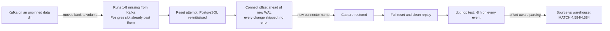

# Incident review: lost CDC events, silent capture stop and an 8-hour latency error

**Period:** 2026-11-09 to 2026-11-24 · **Status:** resolved; follow-up actions listed below · **Format:** blameless review

## Summary

Three separate faults hit the pipeline in a row. Each one hid the next:

1. **Kafka lost replay events.** The broker had been writing to an unpinned data directory instead of the `banking_kafka_data` volume. Once it was moved back to that volume, every change from replay runs 1–8 (22,014 `fin_trans` inserts plus their updates and deletes) was missing from Kafka. PostgreSQL had already counted them as delivered, so they could not be sent again.
2. **Debezium stopped capturing without any error.** PostgreSQL was then re-initialised, which restarted its write-ahead log near zero. Kafka Connect still held the old saved position, so Debezium treated every new change as already processed and dropped it. The replication slot stayed `active` and no log showed an error.
3. **Every hop-latency figure was off by 8 hours.** A landing timestamp stored as text carried a `-0800` offset, and the dbt macro that parsed it discarded the offset.

I rebuilt the platform from a clean state rather than patch partial history. A full source-to-warehouse reconciliation then matched all **4,584 accounts with 0 mismatches** (`recon_run_id` 201).



## Impact

| Area | Effect |
|---|---|
| Replay runs 1–8 (old database) | 22,014 `fin_trans` inserts and their updates and deletes never reached the warehouse through CDC. They could not be recovered from Kafka or from the PostgreSQL WAL. |
| Faker and replay runs on 2026-11-23 before the fix | Every change was dropped by Debezium. No topics were created. |
| Latency metrics | `landing_seconds` read about −28,800 s and `load_seconds` about +28,800 s for every replay event. The per-hop p50/p95 figures were wrong; the end-to-end figure was unaffected. |
| Correctness of loaded data | Not affected after the rebuild. Final reconciliation: MATCH, 4,584 accounts checked, 0 mismatched. |


## Timeline (ET)

| When | Event |
|---|---|
| Nov 2, 01:40 | `banking_kafka_data` volume formatted (cluster `banking-mds-cluster`). |
| Nov 8, 17:52 – Nov 9, 13:04 | Replay runs 1–8 commit 22,014 `fin_trans` rows in PostgreSQL. Kafka is writing to a different, unpinned data directory. The S3 sink is failing with S3 403 errors, so run 8 never lands in S3. |
| Nov 22, ~18:00 | Volume backed up (`banking_kafka_data-2026-11-22.tgz`). Kafka recreated on `banking_kafka_data` with `KAFKA_LOG_DIRS` and the image version pinned. Topics are back. |
| Nov 23, 00:10 | Offsets show only the baseline load (district 77, client 5,369, account 4,500, …) and one `fin_trans` message. Debezium's saved position (`0/48C8C88`) equals the slot's `confirmed_flush_lsn`, and its timestamp is the last run-8 insert. **Runs 1–8 cannot be recovered.** |
| Nov 23, 00:50 – 02:20 | Reset attempts stall. The Connect REST API intermittently returns nothing, and the slot is still held by the running connector. |
| Nov 23, 02:15 – 02:19 | Two Faker runs complete in PostgreSQL. No topics appear. |
| Nov 23, 02:22 | Diagnosis: the database WAL went **backwards** (`0/4A52E58` → `0/2C9A538`) and `fin_trans` went from 22,014 to 7,000 rows, so PostgreSQL had been re-initialised. Connect's saved position `0/48C8C88` was ahead of it, so every event was skipped. |
| Nov 23, ~02:30 | Connector re-registered as `postgres-connector-v2` (new name, no saved offsets) after dropping the slot. The snapshot restores the current state. |
| Nov 23, 02:34 | Replay run 3 (new database): 5,622 events planned, and Kafka grew by exactly 5,622. |
| Nov 23, 20:51 | dbt build: client SCD2 overlap (12 rows) and missing replay events (8 rows) fail; snapshot-recovered events (3) and negative hops (2,514) warn. 29 downstream nodes skipped. |
| Nov 23, 20:54 | **Decision:** full reset of PostgreSQL, Kafka, S3 landing and Snowflake (`TRUNCATE`, which also clears COPY load history), then replay in order with checks after every run. PostgreSQL volume name pinned. |
| Nov 24, 03:43 | Clean baseline, Faker batch and replay runs complete; every run's delivery check passes. The client SCD2 overlap test passes on clean data. |
| Nov 24, 03:52 | Hop test still warns: 1,056,401 events with `landing_seconds` median −28,799.6 s, `load_seconds` +29,114.6 s, sum 314.8 s. Session `TIMEZONE` is `America/Los_Angeles`. |
| Nov 24, 12:40 | Root cause of the 8 hours: `LANDING_INGESTED_AT` is `VARCHAR` holding `'2026-11-24 00:12:18.542 -0800'`; the `cdc_timestamp` macro parsed it with `try_to_timestamp_ntz`, which drops the offset. |
| Nov 24, 15:51 | Source-window export (4,584 rows) reconciled: **MATCH, 4,584 checked, 0 mismatched** (`recon_run_id` 201). |

## Root causes

### 1. Kafka data directory not pinned

The broker's data directory came from the image default rather than the Compose configuration, so the broker wrote to storage outside the `banking_kafka_data` volume. Changes written there were lost when Kafka was moved back to the volume. A second sink container in the same consumer group, crash-looping for lack of AWS credentials, also kept taking partitions from the host sink. Separately, the S3 403 meant run 8 never reached S3 before the move.

PostgreSQL could not resend anything, because Debezium had already confirmed every LSN through the end of run 8 (`confirmed_flush_lsn` = saved offset = `0/48C8C88`). Logical replication only keeps WAL that has not been confirmed.

### 2. Saved Connect offset outlived the source database

Kafka Connect stores Debezium's position in the `connect-offsets` topic, keyed by connector name, independently of PostgreSQL. When PostgreSQL was re-initialised, its WAL restarted near zero, but the stored position did not. Debezium skips any event at or below its stored LSN, so it discarded every new change. The slot was `active`, the task was `RUNNING`, and nothing was logged. The trigger for the re-initialisation was not confirmed; the likely cause is a `docker compose down -v` or a change to the PostgreSQL volume name.

### 3. Timestamp stored as text, parsed without its offset

`COPY` writes `LANDING_INGESTED_AT` into a `VARCHAR` column. Snowflake renders it using the session time zone, so the text reads `00:12:18.542 -0800` for the instant `08:12:18.542 UTC`. The `cdc_timestamp` macro passed that text to `try_to_timestamp_ntz`, which ignores the offset and keeps `00:12:18.542`. The landing time therefore looked 8 hours earlier than it was, moving 8 hours from the landing hop into the load hop. CI never caught it because the emulator fixtures wrote `+00:00`, and dropping a zero offset happens to give the right answer.

## Detection

| Fault | What detected it | Automated? |
|---|---|---|
| Kafka data loss | Replay delivery reconciliation (`MISSING`, `RECOVERED_BY_SNAPSHOT`) and topic offsets compared with source row counts | Partly. Reconciliation flagged it; the cause needed manual investigation |
| Silent capture stop | Manual check: no topics after two Faker runs, then comparing the WAL position with Connect's saved offset | **No.** This was the largest gap |
| 8-hour latency error | dbt test `assert_replay_hops_not_negative` (tolerates 5 s of clock skew) | Yes |
| Client SCD2 overlap | dbt test `assert_scd2_client_no_overlap` | Yes. It came from mixed old and new database IDs and cleared after the reset |

Keeping the expected-change record (`replay_event`) outside the Kafka path was the key design decision. Because it travels separately, a Kafka failure can be measured instead of silently shrinking the data.

## Recovery

1. Backed up the Kafka volume before any change.
2. Pinned the Kafka data directory and image version, and moved the Docker sink behind an opt-in profile.
3. Restored capture with a new connector name, so Connect started without the stale offset.
4. Rebuilt everything from empty: dropped the Docker volumes, deleted `landing/` in S3, and ran `TRUNCATE` on every Snowflake schema. `TRUNCATE` matters here: `DELETE` keeps the COPY load history, so files whose names repeat after topic offsets restart at 0 would have been skipped.
5. Replayed one run at a time, waiting for sink lag 0 and checking delivery status before starting the next.
6. Exported source account windows and reconciled: MATCH, 4,584/4,584.

## What went well and what didn't

**Went well**
- Reconciliation against an independent expected-change record surfaced losses that row counts alone would have hidden.
- dbt tests with explicit tolerances caught the time-zone error on clean data.
- Checking each run before starting the next kept every later failure traceable to one run.

**Went poorly**
- Nothing alerted on a stopped capture. The slot looked healthy while every event was dropped.
- Storage locations (the Kafka data directory, the PostgreSQL volume name) relied on defaults.
- A timestamp was stored as text, so its meaning depended on session settings.
- CI fixtures used only UTC offsets, which hid a parsing bug.

## Action items

| # | Action | Status |
|---|---|---|
| 1 | Pin the Kafka data directory (`KAFKA_LOG_DIRS`) and image version (`KAFKA_VERSION`) | Done (`bce0598`) |
| 2 | Put the Docker S3 sink behind the opt-in `docker-sink` profile | Done |
| 3 | Pin the PostgreSQL volume name (`banking_postgres_data`) | Done during reset — confirm committed |
| 4 | `scripts/check_cdc_position.py`: fail when the slot is missing or inactive, or when Debezium's saved LSN is ahead of `pg_current_wal_lsn()`. Run it as the DAG's first task | In progress |
| 5 | Offset-aware parsing in `cdc_timestamp`, plus an emulator fixture covering `-0800`, `Z`, `+00:00` and naive strings, proven by a mutation run against the old macro | In progress |
| 6 | Set `TIMEZONE = 'UTC'` for the dbt and Airflow Snowflake users | Open |
| 7 | Consider storing `LANDING_INGESTED_AT` as `TIMESTAMP_TZ` instead of `VARCHAR` | Open (needs a RAW reload) |
| 8 | Fix `snowflake/05_audit_control_tables.sql`, which labels `raw_loaded_at` as `landed_at` | Open |
| 9 | Debezium heartbeat for idle periods (`heartbeat.interval.ms` plus `heartbeat.action.query`), filtered out of staging | Optional |

## Evidence queries

```sql
-- Per-hop latency, by hop
SELECT median(capture_seconds), median(landing_seconds), median(load_seconds),
       median(landing_seconds + load_seconds)
FROM AUDIT.RECON_REPLAY_DELIVERY;

-- Final source-vs-warehouse reconciliation
SELECT status, accounts_checked, accounts_mismatched
FROM AUDIT.RECON_RUN WHERE recon_run_id = 201;
```

```bash
# Debezium position vs PostgreSQL (the check that would have caught fault 2)
uv run python scripts/check_cdc_position.py
```
