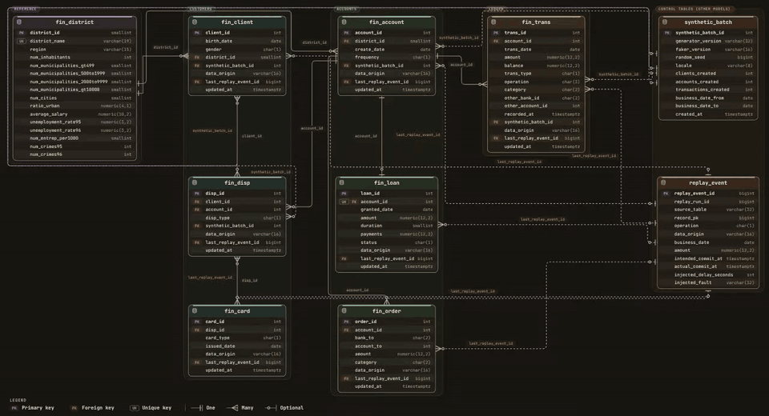
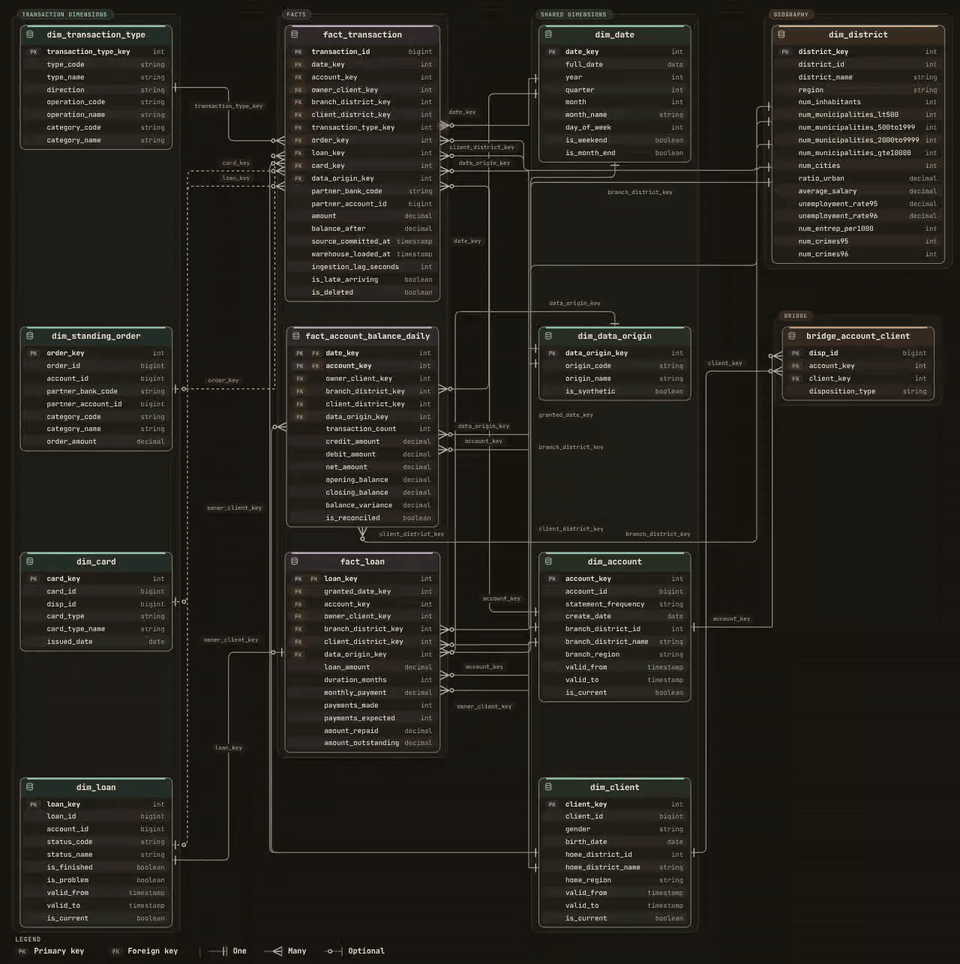
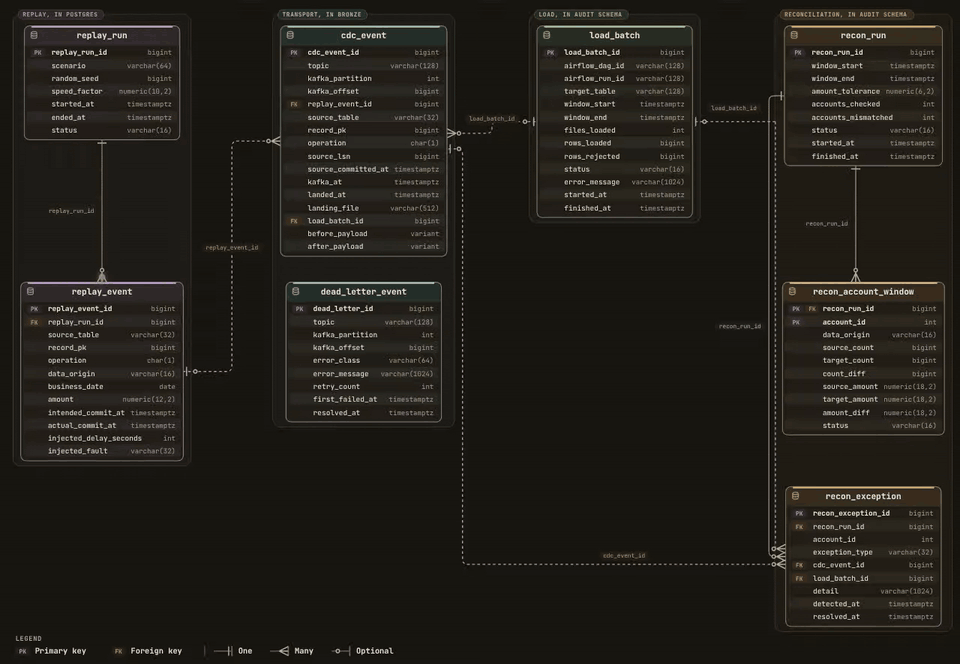
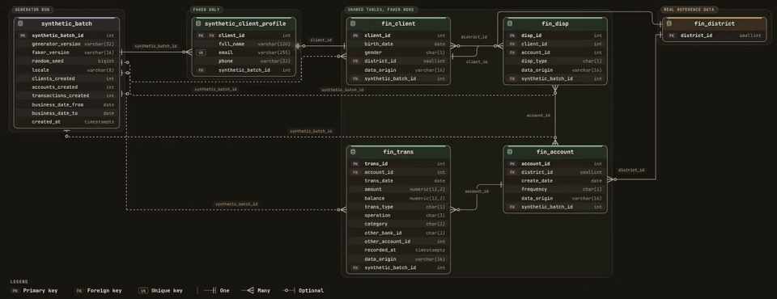
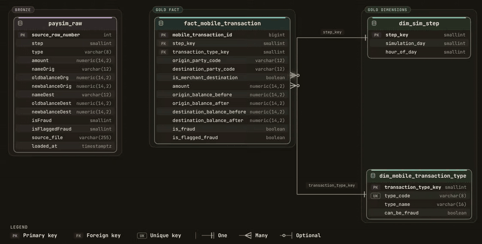

# Real-Time Banking Transaction Lakehouse & Financial Reconciliation Platform

[](.github/workflows/ci.yml)

A banking data platform that turns historical transactions into a stream of real PostgreSQL changes, captures them through Debezium and Kafka, and lands the CDC records as Parquet in Amazon S3.

**Czech banking data + Python replay/Faker → PostgreSQL → Debezium → Kafka → Python consumer → S3 → Snowflake → dbt → Power BI**

The project is built around two questions: **did every source change reach its destination, and do the resulting balances still reconcile?** Historical banking data supplies the business relationships; controlled replay supplies inserts, updates, deletes and late arrivals that exercise the pipeline.

The pipeline runs from PostgreSQL through **S3 landing, Snowflake RAW and dbt Silver/Gold**, orchestrated by an Airflow 3 DAG that records every load in `AUDIT.LOAD_BATCH`. Daily balance reconciliation runs in dbt; source-versus-warehouse account-window reconciliation runs as an optional DAG step. Replay-event delivery reconciliation and Power BI are the next layers. The intended delivery model is **near-real-time analytics**: continuous CDC capture followed by batch or micro-batch warehouse loads.


*The architecture shows the complete target platform, including the warehouse, dead-letter handling, orchestration and dashboards still to be implemented. The current landing target is Amazon S3; the diagram also shows MinIO as an S3-compatible alternative.*

**Explore:** [What gets built](#what-gets-built) · [Source data](#source-data) · [Data model diagrams](#data-model-diagrams) · [The pipeline](#the-pipeline) · [Financial reconciliation](#financial-reconciliation) · [Setup](#setup) · [Tests](#tests) · [Known gaps](#known-gaps)

## Tech stack

**Implemented path:** Python 3.12+ · uv · PostgreSQL 15 · Faker · Debezium 2.2 / Kafka Connect · Apache Kafka · confluent-kafka · PyArrow · Boto3 · Amazon S3 · Docker Compose · pytest

**Warehouse and orchestration:** Snowflake (storage integration, external stage, `COPY INTO`) · dbt 1.10 · Apache Airflow 3.3 · GitHub Actions with a fakesnow Snowflake emulator.

**Planned consumption:** Power BI.

## Source data

### Czech banking: the core workload

The foundation is the anonymized **PKDD'99 Czech banking dataset**, using a Teradata TSV adaptation. It contains connected account, customer, card, loan and transaction records, so the pipeline can be checked against business relationships as well as row counts.

| Table | Reference rows | Grain |
|---|---:|---|
| `fin_trans` | 1,056,320 | One posted transaction |
| `fin_account` | 4,500 | One bank account |
| `fin_client` | 5,369 | One client |
| `fin_disp` | 5,369 | One client's ownership or disposition on an account |
| `fin_card` | 892 | One issued card |
| `fin_loan` | 682 | One loan contract |
| `fin_order` | 6,471 | One standing order |
| `fin_district` | 77 | One district |

These are reference counts for the full historical dataset, documented in the [modelling notes](docs/data_model.md), rather than current database counts. A limited replay loads only part of the transaction history; Faker inserts and simulated deletes change the totals.

The TSV adaptation already shifts dates forward by 20 years and divides amounts by 10. Transactions therefore retain **2013–2018 business dates**. The loader preserves those supplied values rather than applying the conversion again.

### Three workloads, explicit provenance

| Workload | Purpose | How it stays identifiable |
|---|---|---|
| **Czech historical data** | Transaction ledger, account balances, customer relationships and loans | `data_origin = 'czech_original'`; no synthetic batch |
| **Faker extension** | Repeatable customer, account and transaction inserts | `data_origin = 'faker_synthetic'`; IDs start at `900000000`; records link to `synthetic_batch` |
| **PaySim** | Separate mobile-money fraud analytics workload | Separate model and planned schema; no joins to Czech customers or accounts |

Faker uses the `cs_CZ` locale. The generator stores the seed, generator/Faker versions, locale and batch parameters, and creates names and contact details only in `synthetic_client_profile`. Synthetic records remain distinguishable from the anonymized source.

**Replay does not turn this into a live bank feed.** It makes real changes in PostgreSQL from static history. A replayed original record keeps its original provenance; `last_replay_event_id` identifies the simulated change.

## Data model diagrams

The five diagrams below use animated previews of the supplied six-second WebM exports. Each has a link to its original video and an interactive HTML version. Download and open the HTML file in a browser to explore it; the JSON model definitions live in [`docs/data_models/`](docs/data_models/README.md).

### 1. PostgreSQL source schema

The eight banking tables, their relationships, synthetic batch labels and links back to replay events. Source keys and foreign keys are enforced in [PostgreSQL DDL](postgres/schema.sql).

[](docs/webm-diagrams/czech-banking-postgresql-source-schema.webm)

[Original WebM](docs/webm-diagrams/czech-banking-postgresql-source-schema.webm) · [Interactive HTML](docs/html-diagrams/czech_oltp.html) · [Model definition](docs/data_models/czech_oltp.erd.json)

### 2. Czech banking Gold schema

A **fact constellation**: transaction, daily account-balance and loan facts share dimensions. Branch district and client home district are separate roles of the same district dimension; the account-client bridge preserves owners and disponents.

[](docs/webm-diagrams/czech-banking-gold-star-schema.webm)

[Original WebM](docs/webm-diagrams/czech-banking-gold-star-schema.webm) · [Interactive HTML](docs/html-diagrams/czech_gold.html) · [Modelling rules](docs/data_model.md)

### 3. Replay and reconciliation control tables

Implemented source controls (`replay_run`, `replay_event`) connect to the planned transport, load and reconciliation records. This separates what the simulator intended to deliver from what the downstream pipeline observed.

[](docs/webm-diagrams/cdc-replay-and-reconciliation-control-tables.webm)

[Original WebM](docs/webm-diagrams/cdc-replay-and-reconciliation-control-tables.webm) · [Interactive HTML](docs/html-diagrams/cdc_reconciliation.html) · [Model definition](docs/data_models/cdc_reconciliation.erd.json)

### 4. Faker synthetic layer

Synthetic customers, accounts, dispositions and transactions reuse the banking tables while keeping batch lineage and contact profiles explicit. Faker does not manufacture loan, card or standing-order relationships.

[](docs/webm-diagrams/faker-synthetic-layer.webm)

[Original WebM](docs/webm-diagrams/faker-synthetic-layer.webm) · [Interactive HTML](docs/html-diagrams/faker.html) · [Model definition](docs/data_models/faker.erd.json)

### 5. PaySim fraud workload

A separate synthetic mobile-money model for fraud analysis. The diagram is a design artifact; PaySim ingestion and analytics are not implemented in this checkout, and its dataset is not included.

[](docs/webm-diagrams/paysim-fraud-workload.webm)

[Original WebM](docs/webm-diagrams/paysim-fraud-workload.webm) · [Interactive HTML](docs/html-diagrams/paysim.html) · [Model definition](docs/data_models/paysim.erd.json)

## The pipeline

### 1. Load the baseline, then replay changes

[`data-generator/generator.py`](data-generator/generator.py) provides three commands:

| Command | Behavior |
|---|---|
| `load` | Apply the source DDL and load the seven reference tables from TSVs. Leave `fin_trans` for replay. Repeated loads skip existing keys and recorded deletions |
| `faker` | Insert a seeded batch of synthetic clients, accounts, dispositions and transactions. A repeated seed skips an existing batch |
| `replay` | Insert historical transactions in business-date order, optionally mixing in allowed updates, deletes and delayed changes |

The simulator records planned changes in `replay_event` **before** applying them, then records their delivery time. Run metadata captures the seed, pacing and completed, interrupted or failed status. This creates source-side evidence for the downstream reconciliation design.

Original transaction amounts and business dates stay intact. Both Python validation and a PostgreSQL trigger reject updates or deletes of `czech_original` transactions. Simulated updates cover client districts, account statement frequencies, loan status and standing-order amounts; deletes cover orders, cards and synthetic transactions.

### 2. Capture PostgreSQL snapshots and WAL changes

The [connector configuration](kafka-debezium/generate_and_post_connector.py) uses `pgoutput`, the `banking_slot` replication slot and topic prefix `banking_server`. It captures the eight `public.fin_*` tables:

```text
banking_server.public.fin_account
banking_server.public.fin_card
banking_server.public.fin_client
banking_server.public.fin_disp
banking_server.public.fin_district
banking_server.public.fin_loan
banking_server.public.fin_order
banking_server.public.fin_trans
```

Initial rows arrive as snapshot reads (`r`); subsequent changes arrive as creates (`c`), updates (`u`) and deletes (`d`). `REPLICA IDENTITY FULL` supplies before-images. The source control tables are excluded from this connector; their separate warehouse audit load is part of the orchestration design.

### 3. Preserve the change envelope in Parquet

The [consumer](consumer/banking_sink/) keeps one buffer per Kafka topic-partition and flushes on batch size or elapsed time. Each Parquet record includes:

- **Transport identity:** `event_id = topic:partition:offset`, topic, partition and offset.
- **Source lineage:** database, schema, table, PostgreSQL LSN and transaction ID when supplied.
- **Change contents:** operation, snapshot flag, key, before-image, after-image and the original payload as JSON.
- **Timing:** source, Debezium and Kafka timestamps when available, plus the landing record's ingestion timestamp.

Files use Snappy compression and this layout:

```text
s3://<bucket>/<S3_PREFIX>/
  table=fin_trans/
    ingest_date=YYYY-MM-DD/
      topic=banking_server.public.fin_trans/
        partition=0/
          offsets=<first-offset>-<last-offset>.parquet
```

`ingest_date` is the UTC landing date, not the historical business date. The same envelope handles all captured tables without hardcoding their row schemas.

### 4. Commit Kafka offsets after persistence

The consumer disables automatic commits and offset storage. It writes a partition's batch to S3 first, then synchronously commits the next Kafka offset. A failed upload leaves that batch uncommitted.

Conditional object writes prevent overwriting an existing key. If that key already exists, the writer checks its event-identity hash before treating the upload as a retry. This protects identical offset ranges; it is **not an end-to-end exactly-once guarantee**. Downstream Bronze processing must deduplicate by event identity because retries can produce different batch boundaries or landing dates.

Malformed or unsupported events stop the sink instead of being silently skipped. The parser handles Debezium JSON envelopes with or without schema wrappers and preserves tombstones if encountered. The current connector disables tombstone emission; Avro, Protobuf and flattened change records are unsupported.

### 5. Build the warehouse and analytics layers

The warehouse design moves landed CDC through three layers:

| Layer | Intended processing |
|---|---|
| **Bronze** | Preserve raw changes, file lineage and load history; deduplicate transport events |
| **Silver** | Parse payloads, normalize codes and nulls, apply deletes and build SCD Type 2 history for changing dimensions |
| **Gold** | Build shared dimensions, transaction and loan facts, daily account balances and business marts |

| Gold fact | Grain | Business use |
|---|---|---|
| `fact_transaction` | One posted transaction | Ledger, transaction mix, standing-order payments and card withdrawals |
| `fact_account_balance_daily` | One account per day with activity | Opening/closing balance reconciliation and daily cash movement |
| `fact_loan` | One loan contract | Loan exposure, repayment progress and portfolio status |

Shared dimensions include date, account, client, district, transaction type, standing order, loan, card and data origin. `bridge_account_client` represents account ownership and disposition rights.

The model keeps **two clocks**: the historical business date for reporting, and source/warehouse timestamps for delivery lag and SCD2 version selection. Balances are semi-additive: aggregate across accounts at the same point in time, but do not sum balances across dates. Full rules are in [`docs/data_model.md`](docs/data_model.md).

## Financial reconciliation

The reconciliation design checks **transport completeness** separately from **financial consistency**. A matching row count alone cannot show that amounts, operations or balances arrived correctly.

| Check | Intended evidence or rule |
|---|---|
| Expected versus delivered changes | Compare `replay_event` with observed CDC by source key and operation; retain planned-but-undelivered changes |
| Source versus target windows | Compare counts and signed amounts by account, time window and data origin |
| Daily balances | `closing_balance = prior_stated_closing_balance + daily_net_amount`, within `0.02` |
| Standing-order payments | Match account, partner bank/account and absolute amount; record missing or ambiguous matches |
| Loan repayments | Compare repayments with loan terms, using the documented `0.05` amount tolerance for source rounding |
| Late arrivals and duplicates | Use business and pipeline timestamps for lateness; use transport identity for duplicate delivery |
| Load failures | Track rejected rows, failed batches and unresolved exceptions in the planned audit schema |

The source has dates without transaction times, and transaction IDs are not chronological. Reconciliation therefore works at **account-day grain** rather than assuming per-row running balances can be reconstructed by ID. Ambiguous same-day closing balances need explicit exception handling.

The [modelling notes](docs/data_model.md#reconciliation-rules-tested-against-the-full-dataset) contain the recorded dataset profiling results and edge cases. Those results inform the design. `fact_account_balance_daily` implements the account-day balance rule and labels every day `RECONCILED`, `VARIANCE`, `AMBIGUOUS_CLOSING` or `NO_COMPARABLE_PREVIOUS_DAY`; `scripts/reconcile.py` writes source-versus-warehouse count and amount checks to `AUDIT.RECON_*`. Comparing `replay_event` with delivered CDC is not implemented yet.

## Repository structure

```text
├── consumer/
│   ├── banking_sink/             # Configuration, envelope parser, Kafka runner, Parquet/S3 writer
│   ├── tests/                    # Event parsing and object-storage unit tests
│   └── Dockerfile                # Containerized sink
├── data-generator/
│   ├── generator.py              # Baseline load, seeded Faker batches, historical replay
│   └── test_generator.py         # Integration self-check using an empty throwaway PostgreSQL
├── kafka-debezium/
│   └── generate_and_post_connector.py
├── postgres/
│   ├── schema.sql                # Source DDL, provenance constraints, replay audit, ledger trigger
│   └── sql_scripts/              # Manual DDL/load scripts
├── docs/
│   ├── Banking CDC Analytics Platform Diagram.png
│   ├── data_model.md             # Gold modelling rules, profiling and reconciliation decisions
│   ├── data_model.png            # Static Gold schema
│   ├── data_models/              # Five JSON model definitions and supporting notes
│   ├── html-diagrams/            # Interactive diagram exports
│   ├── webm-diagrams/            # Original six-second animations
│   └── gif-diagrams/             # Animated README previews
├── docker-compose.yml            # Kafka, Connect, PostgreSQL, sink and Airflow definitions
├── dockerfile-airflow.dockerfile  # Airflow image with Snowflake provider and isolated dbt
├── pyproject.toml                # Python dependencies and consumer pytest configuration
└── uv.lock                       # Locked Python environment
```

Also present: `banking_dbt/` (staging, Silver current state and SCD2 history, Gold star schema and marts), `snowflake/` (numbered setup, COPY and reconciliation SQL), `docker/dags/` (Airflow DAG plus the `banking_pipeline` helper package), `scripts/` (source snapshot export and reconciliation), and `ci/` (emulator fixtures and runner). The dataset and local environment files are gitignored.

## Setup

The steps below run the implemented **PostgreSQL → Kafka → S3** path. Run commands from the repository root.

### 1. Prerequisites and Python environment

- Docker Engine with Docker Compose, and [uv](https://docs.astral.sh/uv/).
- Python 3.12 or newer, managed locally or through uv.
- The eight transformed `fin_*.tsv` files described in the [source adaptation notes](docs/data_models/README.md#from-the-teradata-files-to-postgresql).
- An existing S3 bucket and AWS credentials available through Boto3's credential provider chain, with access to check the bucket, write objects and inspect existing object metadata.

```bash
uv sync --frozen
```

Place the TSV files in `dataset/1999_Czech_financial_dataset_Teradata/`. The loader and replay also accept `--dataset-dir /path/to/files`. The original Teradata `fin_install.btq` is not a PostgreSQL loader.

### 2. Configure the local environments

Create a root `.env` for the PostgreSQL container and host-side generator:

```dotenv
POSTGRES_USER=banking
POSTGRES_PASSWORD=replace-with-local-password
POSTGRES_DB=banking
POSTGRES_HOST=localhost
POSTGRES_PORT=5434

# Required by the Kafka service. Generate once:
#   docker run --rm apache/kafka:latest /opt/kafka/bin/kafka-storage.sh random-uuid
KAFKA_CLUSTER_ID=replace-with-generated-uuid

# Airflow (only used with `--profile airflow`). Defaults apply when unset; change them
# anywhere other than a local machine.
AIRFLOW_DB_USER=airflow
AIRFLOW_DB_PASSWORD=replace-with-another-local-password
AIRFLOW_DB_NAME=airflow
AIRFLOW_ADMIN_USER=admin
AIRFLOW_ADMIN_PASSWORD=admin
AIRFLOW_JWT_SECRET=replace-with-a-long-random-string
```

Create `kafka-debezium/.env` with the same database name and credentials, but the **Docker-network** database address. The script runs on the host, while the registered connector connects from inside Docker:

```dotenv
POSTGRES_HOST=postgres
POSTGRES_PORT=5432
POSTGRES_USER=banking
POSTGRES_PASSWORD=replace-with-local-password
POSTGRES_DB=banking
```

Create `consumer/.env` for the host-run sink:

```dotenv
KAFKA_BOOTSTRAP_SERVERS=localhost:29092
KAFKA_CONSUMER_GROUP_ID=banking-cdc-s3-v1
KAFKA_TOPIC_PATTERN=^banking_server\.public\.fin_(account|card|client|disp|district|loan|order|trans)$
AUTO_OFFSET_RESET=earliest

S3_BUCKET=your-existing-bucket-name
S3_PREFIX=landing/cdc
AWS_REGION=us-east-1
S3_ENDPOINT_URL=

BATCH_SIZE=5000
FLUSH_INTERVAL_SECONDS=15
LOG_LEVEL=INFO
```

Keep credentials local. Exported variables take precedence over dotenv files. `KAFKA_TOPICS`, if set, takes precedence over `KAFKA_TOPIC_PATTERN`.

For AWS S3, `S3_BUCKET` is the bucket name alone and `S3_PREFIX` is the object path. Leave `S3_ENDPOINT_URL` empty so Boto3 selects the AWS endpoint. A custom endpoint is a service address such as `http://localhost:9000`, without a bucket or object path; this Compose file does not provision MinIO.

### 3. Start the core services and load the baseline

```bash
docker compose up -d postgres kafka connect
uv run python3 data-generator/generator.py load
```

Wait for PostgreSQL to accept connections before loading. The generator creates the source schema and loads the seven reference tables; historical transactions enter through replay. Use a fresh compatible database for the initial setup: the loader checks schema shape and does not migrate older incompatible tables.

### 4. Register and check the Debezium connector

Once Kafka Connect responds on port `8083`:

```bash
uv run python3 kafka-debezium/generate_and_post_connector.py
curl -fsS http://localhost:8083/connectors/postgres-connector/status
docker exec kafka /opt/kafka/bin/kafka-topics.sh --bootstrap-server localhost:9092 --list
```

Check that both the connector and its task are `RUNNING`, and that matching `banking_server.public.fin_*` topics exist. The transaction topic can appear later, once replay starts inserting transactions. If the connector already exists, the registration script leaves its configuration unchanged.

### 5. Start the sink

In one terminal:

```bash
uv run python3 -m consumer.banking_sink
```

Use the dotted module name with `-m` so Python resolves the package's relative imports. The sink checks bucket access before subscribing; it does not create the bucket.

To run the sink **inside Docker instead**, provide AWS credentials to that runtime, then run the command below. Compose overrides `KAFKA_BOOTSTRAP_SERVERS` with `kafka:9092`; keep `localhost:29092` in `consumer/.env` for host execution.

```bash
docker compose up -d --build kafka-s3-sink
```

The host uses `localhost:29092`; containers use `kafka:9092`. A host AWS profile is not automatically mounted into the sink container. Choose one sink runtime for the demo so multiple consumers do not share the same group unexpectedly.

### 6. Replay transactions and inspect landing

In another terminal, insert the next 5,000 historical transactions without pacing or simulated updates/deletes:

```bash
uv run python3 data-generator/generator.py replay \
  --limit 5000 --speed-factor 0 --updates 0 --deletes 0
```

`--speed-factor 86400` replays one business day per wall-clock second; `0` disables pacing. Original `trans_date` values stay historical. A subsequent replay continues with history transactions not already inserted or recorded as delivered.

Watch for `Landed ...` followed by `Committed ...` in the sink logs, then inspect the configured S3 prefix for Parquet objects. Snapshot records also create landing files before transaction replay.

For an optional mutation and late-arrival scenario, first add a synthetic batch, then replay with explicit change counts:

```bash
uv run python3 data-generator/generator.py faker --seed 42 --clients 100
uv run python3 data-generator/generator.py replay \
  --limit 1000 --speed-factor 0 --updates 8 --deletes 3 \
  --late-fraction 0.2 --late-delay-seconds 5
```

This scenario changes source records and records the planned/delivered changes in the replay audit tables. Original transactions remain protected. Without explicit flags, replay defaults to 50 simulated updates and 20 deletes.

### 7. Set up Snowflake

Run these scripts once, in a Snowsight worksheet, in this order:

| Step | Script | Notes |
|---|---|---|
| 1 | `snowflake/00_bootstrap.sql` | Warehouse, database, schemas, `FINANCE_DBT_ROLE` |
| 2 | `snowflake/01_storage_integration.sql` | Set your IAM role ARN and bucket first |
| 3 | `DESC INTEGRATION BANKING_S3_INTEGRATION` | Put `STORAGE_AWS_IAM_USER_ARN` and `STORAGE_AWS_EXTERNAL_ID` into the IAM role's trust policy |
| 4 | `snowflake/02_stage_and_raw.sql` | CDC stage, file format, `RAW.CDC_EVENTS` |
| 5 | `snowflake/05_audit_control_tables.sql` | `AUDIT` tables and views |
| 6 | `snowflake/06_audit_stages.sql` | Source-snapshot and dead-letter stages |

Copy `snowflake/.env.example` to `snowflake/.env` and fill in the credentials. Airflow, dbt and `scripts/reconcile.py` all read this one file.

### 8. Run the warehouse pipeline with Airflow

Airflow 3 runs as five services: `airflow-postgres`, a one-shot `airflow-init` (`db migrate` plus admin user), `airflow-apiserver` (UI and Execution API), `airflow-scheduler` (LocalExecutor) and `airflow-dag-processor`. They sit behind a Compose profile, so steps 3–6 never build the Airflow image.

```bash
docker compose --profile airflow build
docker compose --profile airflow up -d
docker compose logs airflow-init          # ends with "airflow-init complete"
docker compose ps                         # airflow-apiserver (healthy), scheduler and dag-processor up
```

Open http://localhost:8080 and sign in with `AIRFLOW_ADMIN_USER` / `AIRFLOW_ADMIN_PASSWORD`. Then:

1. **Trigger `banking_preflight`.** Its three tasks check, in order: mounted SQL and dbt files; the dbt profile and Snowflake login (`dbt debug`); Snowflake objects and S3 access through the stage. A failure names the broken piece.
2. **Unpause `banking_s3_snowflake`.** Every 15 minutes it loads new S3 files into `RAW`, loads the audit feeds, runs `dbt build`, and records each load in `AUDIT.LOAD_BATCH`.

```sql
SELECT target_table, status, files_loaded, rows_loaded, error_message, finished_at
FROM BANKING_LAKEHOUSE.AUDIT.LOAD_BATCH ORDER BY finished_at DESC LIMIT 10;
```

Source-versus-warehouse reconciliation stays manual until a snapshot exists:

1. Quiesce replay.
2. Run `scripts/export_source_windows.py`.
3. Run either `scripts/reconcile.py --snapshot-run-id <id> --source-caught-up`, or set `SOURCE_SNAPSHOT_ID` and `RECON_WATERMARK_VERIFIED=true` in `snowflake/.env` so the DAG's last task runs it.

## Tests

Every push and pull request runs [`.github/workflows/ci.yml`](.github/workflows/ci.yml); none of it needs cloud credentials.

| Job | What it proves |
|---|---|
| lint + unit tests | Consumer parsing and storage, plus Snowflake `COPY` result handling used by the DAG |
| dbt build on Snowflake emulator | All models and data tests build on fixture CDC events, then twelve outcome checks: transport dedup, deletes, origin labelling, account and loan SCD2 version-in-force, `-1`/`-2` conditional keys, detection of an injected 5.00 balance variance, and Debezium re-snapshot handling |
| Airflow DAG import | Both DAGs load in Airflow 3.3.2 with the expected task order; the Snowflake connection builder handles credentials safely; `docker compose --profile airflow config` resolves |

Run them locally:

```bash
uv sync --frozen --all-groups
uv run pytest -q                              # unit tests
uv run python ci/run_dbt_emulator.py          # dbt build + outcome checks, no Snowflake account
```

The emulator is [fakesnow](https://github.com/tekumara/fakesnow), which runs Snowflake SQL on DuckDB. The few Snowflake functions it lacks are shimmed in `ci/run_dbt_emulator.py` for CI only; see [`ci/README.md`](ci/README.md). It checks model logic, not Snowflake-specific behaviour such as stages, `COPY` or warehouse sizing.

They cover schema-less and schema-wrapped CDC, snapshot reads, deletes, tombstones, malformed records, Parquet output, identical-batch retries and mixed-partition rejection. Storage tests use a fake S3 client.

The generator has a separate [integration self-check](data-generator/test_generator.py), outside default pytest discovery. It needs the dataset and an **empty throwaway PostgreSQL database**. Set all connection variables explicitly and use a separate port, for example:

```bash
POSTGRES_HOST=127.0.0.1 POSTGRES_PORT=55432 \
POSTGRES_USER=gentest POSTGRES_PASSWORD=your-test-db-password POSTGRES_DB=gentest \
uv run --frozen python3 data-generator/test_generator.py
```

The self-check refuses the Compose database port `5434` and any database with existing public tables. It exercises repeatable loads, Faker provenance and reproducibility, replay changes, ledger protection, late arrivals, interruption/resume and an injected apply failure. It is separate from live CDC-to-S3 verification.

## Troubleshooting

| Symptom | Check |
|---|---|
| `attempted relative import with no known parent package` | Run `uv run python3 -m consumer.banking_sink` from the repository root |
| `HeadBucket` returns `404` | Verify the bucket name, endpoint and access. For AWS, clear bucket-specific URLs from `S3_ENDPOINT_URL`; the status alone does not prove which condition failed |
| `UNKNOWN_TOPIC_OR_PART` | Check connector/task status and list topics. The pattern must include `banking_server.public.fin_`, and at least one matching data topic must exist |
| Kafka connects to the wrong listener | Use `localhost:29092` on the host and `kafka:9092` in Docker |
| `Failed to resolve 'kafka:9092'` | Check `docker compose ps kafka` and start the broker with `docker compose up -d kafka`. The sink depends on the Kafka service; both must share the Compose network |
| `Schema problem ... lacks columns` | The database has incompatible existing tables. The loader validates schema but does not run migrations |
| Environment edits do not affect a running Docker sink | Recreate it with `docker compose up -d --force-recreate kafka-s3-sink` |

## Known gaps

- **Replay delivery reconciliation:** `replay_run` and `replay_event` are not yet copied to Snowflake, so expected-versus-delivered CDC checks are designed but not running.
- **Incremental models:** Silver and Gold rebuild as full tables on each run, which suits the 1M-transaction dataset but not unbounded growth.
- **Delivery semantics:** The sink is designed for at-least-once delivery. End-to-end duplicate handling and automated recovery checks still need the downstream layers.
- **Failure handling:** Malformed events stop the sink; a dead-letter queue and its remediation workflow are modelled but not implemented. Consumer-loop and rebalance behavior are not covered by the current unit suite.
- **Analytics:** Power BI reports and the separate PaySim workload remain planned; PaySim source data is not bundled.
- **Reproducibility:** Kafka uses the `latest` image tag, and the sink Dockerfile installs unpinned dependencies independently of `uv.lock`.
- **CI scope:** CI covers unit tests, the dbt build on an emulator and DAG import. It does not run Kafka, Debezium or Snowflake end to end, and ruff covers only the newer modules.

## Credits

The project takes architectural inspiration from [Jay61616/banking-modern-datastack](https://github.com/Jay61616/banking-modern-datastack). My implementation uses the Czech banking dataset as its foundation, adds a controlled PostgreSQL replay simulator with explicit provenance and source audit records, and lands full CDC envelopes as Parquet in Amazon S3. It also defines banking reconciliation rules and keeps PaySim fraud modelling separate.
