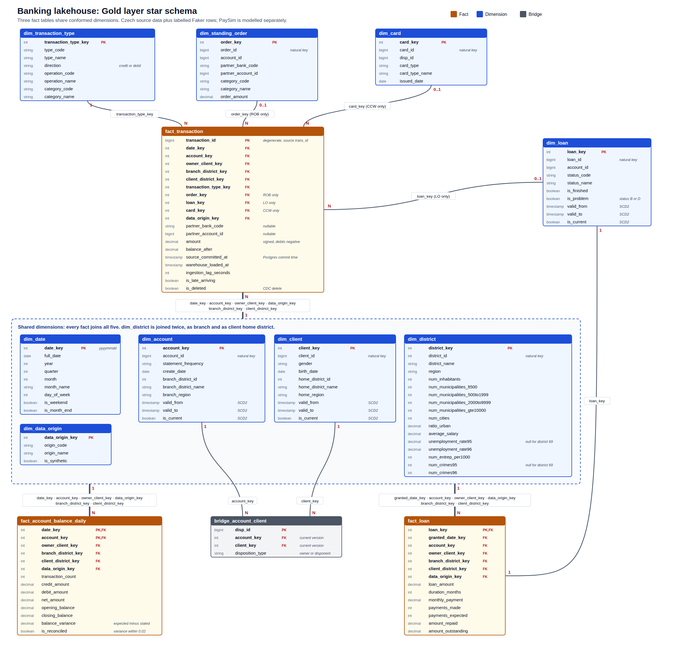

# Gold layer data model: Czech banking

**Decision: star schema with three fact tables sharing dimensions (a fact constellation), not a snowflake.**

- The only real snowflake candidate is `district`, which would hang off both account and client. An account's branch district differs from its owner's home district on 409 of 4,500 accounts, so these are two separate roles. One `dim_district` referenced twice from each fact models that without extra joins.
- Region has no attributes beyond its name, so it stays a column on `dim_district`.
- Power BI filters best over single-hop relationships from dimension to fact.

```mermaid
erDiagram
    dim_date ||--o{ fact_transaction : "transaction date"
    dim_account ||--o{ fact_transaction : "posted to"
    dim_client ||--o{ fact_transaction : "account owner"
    dim_district ||--o{ fact_transaction : "branch and client district"
    dim_transaction_type ||--o{ fact_transaction : "classified as"
    dim_standing_order |o--o{ fact_transaction : "ROB payment of"
    dim_loan |o--o{ fact_transaction : "LO repayment of"
    dim_card |o--o{ fact_transaction : "CCW withdrawal on"

    dim_date ||--o{ fact_account_balance_daily : "balance date"
    dim_account ||--o{ fact_account_balance_daily : "balance of"
    dim_client ||--o{ fact_account_balance_daily : "account owner"
    dim_district ||--o{ fact_account_balance_daily : "branch and client district"

    dim_date ||--o{ fact_loan : "granted date"
    dim_account ||--o{ fact_loan : "drawn on"
    dim_client ||--o{ fact_loan : "account owner"
    dim_district ||--o{ fact_loan : "branch and client district"
    dim_loan ||--|| fact_loan : "contract"

    dim_data_origin ||--o{ fact_transaction : "record source"
    dim_data_origin ||--o{ fact_account_balance_daily : "record source"
    dim_data_origin ||--o{ fact_loan : "record source"

    dim_account ||--o{ bridge_account_client : "has"
    dim_client ||--o{ bridge_account_client : "holds"

    fact_transaction {
        bigint transaction_id PK "degenerate, source trans_id"
        int date_key FK
        int account_key FK
        int owner_client_key FK
        int branch_district_key FK
        int client_district_key FK
        int transaction_type_key FK
        int order_key FK "ROB only"
        int loan_key FK "LO only"
        int card_key FK "CCW only"
        int data_origin_key FK
        string partner_bank_code "nullable"
        bigint partner_account_id "nullable"
        decimal amount "signed, debits negative"
        decimal balance_after
        timestamp source_committed_at "Postgres commit time"
        timestamp warehouse_loaded_at
        int ingestion_lag_seconds
        boolean is_late_arriving
        boolean is_deleted "CDC delete"
    }
    fact_account_balance_daily {
        int date_key PK,FK
        int account_key PK,FK
        int owner_client_key FK
        int branch_district_key FK
        int client_district_key FK
        int data_origin_key FK
        int transaction_count
        decimal credit_amount
        decimal debit_amount
        decimal net_amount
        decimal opening_balance
        decimal closing_balance
        decimal balance_variance "expected minus stated"
        boolean is_reconciled "variance within 0.02"
    }
    fact_loan {
        int loan_key PK,FK
        int granted_date_key FK
        int account_key FK
        int owner_client_key FK
        int branch_district_key FK
        int client_district_key FK
        int data_origin_key FK
        decimal loan_amount
        int duration_months
        decimal monthly_payment
        int payments_made
        int payments_expected
        decimal amount_repaid
        decimal amount_outstanding
    }
    dim_data_origin {
        int data_origin_key PK
        string origin_code
        string origin_name
        boolean is_synthetic
    }
    dim_date {
        int date_key PK "yyyymmdd"
        date full_date
        int year
        int quarter
        int month
        string month_name
        int day_of_week
        boolean is_weekend
        boolean is_month_end
    }
    dim_account {
        int account_key PK
        bigint account_id "natural key"
        string statement_frequency
        date create_date
        int branch_district_id
        string branch_district_name
        string branch_region
        timestamp valid_from "SCD2"
        timestamp valid_to "SCD2"
        boolean is_current "SCD2"
    }
    dim_client {
        int client_key PK
        bigint client_id "natural key"
        string gender
        date birth_date
        int home_district_id
        string home_district_name
        string home_region
        timestamp valid_from "SCD2"
        timestamp valid_to "SCD2"
        boolean is_current "SCD2"
    }
    dim_district {
        int district_key PK
        int district_id "natural key"
        string district_name
        string region
        int num_inhabitants
        int num_municipalities_lt500
        int num_municipalities_500to1999
        int num_municipalities_2000to9999
        int num_municipalities_gte10000
        int num_cities
        decimal ratio_urban
        decimal average_salary
        decimal unemployment_rate95 "null for district 69"
        decimal unemployment_rate96
        int num_entrep_per1000
        int num_crimes95 "null for district 69"
        int num_crimes96
    }
    dim_transaction_type {
        int transaction_type_key PK
        string type_code
        string type_name
        string direction "credit or debit"
        string operation_code
        string operation_name
        string category_code
        string category_name
    }
    dim_standing_order {
        int order_key PK
        bigint order_id "natural key"
        bigint account_id
        string partner_bank_code
        bigint partner_account_id
        string category_code
        string category_name
        decimal order_amount
    }
    dim_loan {
        int loan_key PK
        bigint loan_id "natural key"
        bigint account_id
        string status_code
        string status_name
        boolean is_finished
        boolean is_problem "status B or D"
        timestamp valid_from "SCD2"
        timestamp valid_to "SCD2"
        boolean is_current "SCD2"
    }
    dim_card {
        int card_key PK
        bigint card_id "natural key"
        bigint disp_id
        string card_type
        string card_type_name
        date issued_date
    }
    bridge_account_client {
        bigint disp_id PK
        int account_key FK "current version"
        int client_key FK "current version"
        string disposition_type "owner or disponent"
    }
```

Mermaid source

## Tables

| Table | Grain | Rows | Source | Serves |
|---|---|---|---|---|
| `fact_transaction` | one posted transaction | 1,056,320 | `fin_trans` | Transaction Ledger |
| `fact_account_balance_daily` | one account per day with activity | 814,768 | derived from `fin_trans` | Reconciliation, Customer 360 |
| `fact_loan` | one loan | 682 | `fin_loan` + `LO` transactions | Loan Portfolio |
| `dim_date` | one day, from 2013-01-01 to the end of the current year | at least 2,191 | generated | all |
| `dim_data_origin` | one record source: `czech_original` or `faker_synthetic` | 2 | fixed list | all |
| `dim_account` | one account version | 4,500 + changes | `fin_account` | all |
| `dim_client` | one client version | 5,369 + changes | `fin_client` | all |
| `dim_district` | one district | 77 | `fin_district` | all |
| `dim_transaction_type` | one type + operation + category combination | 15 | distinct values in `fin_trans` | Ledger |
| `dim_standing_order` | one permanent order | 6,471 | `fin_order` | Ledger, Reconciliation |
| `dim_loan` | one loan contract version | 682 + changes | `fin_loan` | Loan Portfolio |
| `dim_card` | one card | 892 | `fin_card` + `fin_disp` | Customer 360 |
| `bridge_account_client` | one client's right on an account | 5,369 | `fin_disp` | Customer 360 |

Row counts cover the original Czech data only. They exclude placeholder members, Faker rows and replay changes. PaySim has its own star in [`data_models/`](data_models/README.md) and shares nothing with this one.

## Modelling rules

- **Measures:** `balance_after`, `opening_balance` and `closing_balance` are semi-additive. Never sum them across dates; take the last value in the period.
- **Client on facts:** every account has exactly one owner, so `owner_client_key` adds no row duplication. Use the bridge only to reach the 869 disponents.
- **Conditional foreign keys:** `order_key`, `loan_key` and `card_key` use `-1` for "not applicable" and `-2` for "expected but no match". Every dimension gets these members so Power BI relationships stay inner-joinable.
- **Partner bank:** it has only a two-letter code, so it stays a column rather than a dimension.
- **`fin_order` has no date:** it is a dimension, and its only timeline comes from the transactions it generates.
- **Loan status:** `dim_loan` is SCD2 because the replay simulator changes loan status. `fact_loan` points at the current version; `fact_transaction` points at the version in force when the transaction was committed.
- **Record source:** filter or slice on `dim_data_origin` so Faker rows are never counted as original data. Every fact row carries it.
- **Two clocks:** `date_key` is the business date from the source. `source_committed_at` and `warehouse_loaded_at` come from the pipeline and drive the lag measures, so replayed history keeps its 2013–2018 dates. SCD2 versions run on the pipeline clock, so facts pick a version by `source_committed_at`, never by `date_key`. A 2013 business date would always land on the first version and hide every simulated change.
- **SCD2 first version:** dbt snapshots set `dbt_valid_from` to the run time, which can be later than a row's commit time, so a join could find no version. Backfill each key's first `valid_from` to `1900-01-01`.
- **District on dimensions and facts:** the fact keys give each event its branch and home district for slicing. `dim_account` and `dim_client` also carry district as plain columns, because disponents appear on no fact and accounts should be countable by branch without a fact. There is no foreign key to `dim_district` from these dimensions, so this stays a star.
- **Bridge keys:** the bridge points at current versions only and is rebuilt each run, so client history does not multiply its rows.

## Reconciliation rules, tested against the full dataset

| Check | Result | Rule |
|---|---|---|
| Running balance per transaction | Fails for about half of rows: `trans_id` is not chronological and there is no time of day | Do not check per row |
| Running balance per account-day | 814,768 of 814,768 days within 0.02 (768,331 exact) | `closing = opening + net`, with opening taken from the prior day's stated closing (`LAG`), not a cumulative sum |
| Finding the stated closing without recursion | The day's closing row is the one whose `balance` is no other same-day row's `balance - amount` (within 0.02). This gives one answer on 220,069 of 220,112 multi-row days. All 814,682 days it can test reconcile within 0.02 | Send the 43 days with no answer, and the day after each, to review; they account for the 86 untested days |
| `ROB` transaction to standing order | 208,282 of 208,283 match one-to-one | Match on account, partner bank, partner account and absolute amount |
| Standing order with no transactions | 382 of 6,471, including all 341 `LE` orders | Report as exceptions. Expect this for every `LE` order |
| `LO` transaction to loan payment | 54% exact, 99.99% within 0.05 | Allow 0.05 tolerance; amounts were rounded when divided by 10 |
| Loan repayment by status | Status `A` averages 100% repaid and `B` 77%. Payments made vs expected: `C` 104%, `D` 81% (expected count is approximated from months since grant) | Use for status consistency tests |
| `CCW` transaction to card | All 8,036 on an account with a card, none before issue | One card per account, so match on account |
| Foreign keys between source tables | 0 orphans across all 8 relationships | `relationships` tests in dbt |

## Source cleanup in Silver

| Issue | Evidence | Treatment |
|---|---|---|
| Duplicate-looking transactions | 1,369 rows share account, date, amount, type and operation | Each has its own `trans_id`, so treat them as separate transactions. Deduplicate on `trans_id` only |
| Placeholder partner account | `other_account_id = 0` with blank bank on 21,881 rows | Load as null |
| Padded or blank codes | `category`, `operation` and order `category` | Trim, then map blank to `UNKNOWN` |
| Blank `operation` | All 183,114 are `IC` interest credits | Label as interest in `dim_transaction_type` |
| Unmatched `ROB` | Transaction 236564 has no partner details | `order_key = -2` |
| Missing district metrics | District 69 (Jesenik): `unemployment_rate95`, `num_crimes95` | Keep null; do not impute |
| Misnamed column | `num_municipalities_gt499` is documented as under 500 inhabitants | Rename to `num_municipalities_lt500` |
| Dataset README date range | It says 2003–2018; transactions run 2013–2018 | Trust the data |
| Young account owners | 328 owners are under 18 by birth year at account opening | Keep; the source has no rule against it |
