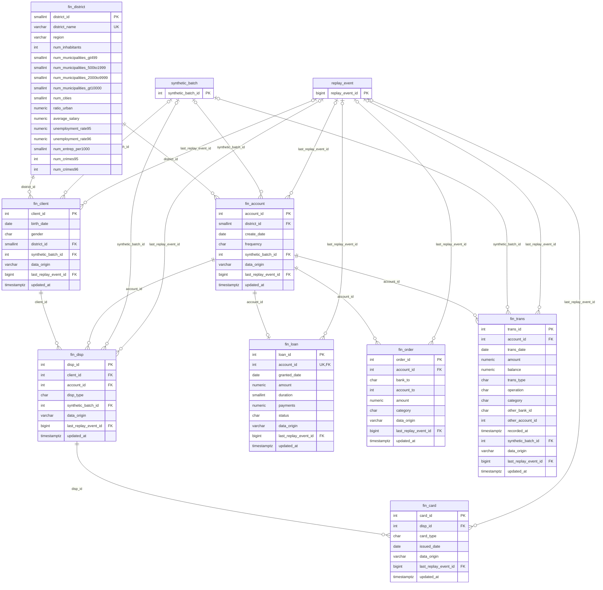
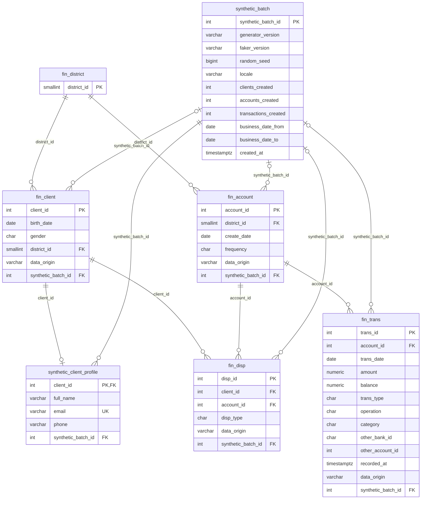
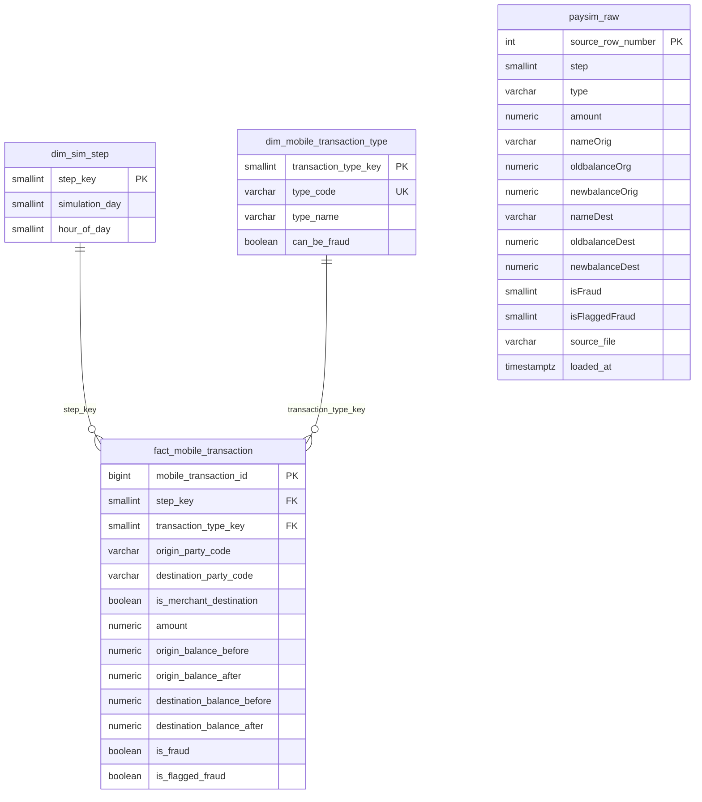
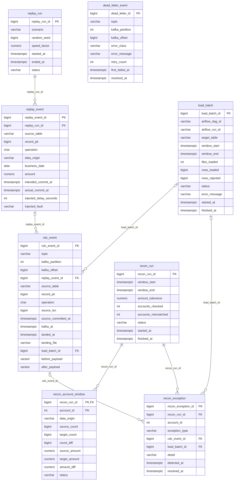

# Data models

These models cover three data sources, kept clearly apart, plus the tables that prove the pipeline moved them correctly.

| Model | Data | Status | Source file |
|---|---|---|---|
| Czech source | PKDD'99 bank data in PostgreSQL | Real, anonymised, historical | [`czech_oltp.erd.json`](czech_oltp.erd.json) |
| Czech Gold | Star schema for Power BI | Real plus labelled Faker rows | [`czech_gold.erd.json`](czech_gold.erd.json), [`../data_model.md`](../data_model.md) |
| Faker layer | Extra customers and transactions | Synthetic, stored with the Czech tables | [`faker.erd.json`](faker.erd.json) |
| PaySim | Mobile-money fraud workload | Synthetic, fully separate | [`paysim.erd.json`](paysim.erd.json) |
| CDC and reconciliation | Replay, transport, load and reconciliation tracking | Pipeline metadata | [`cdc_reconciliation.erd.json`](cdc_reconciliation.erd.json) |

## Rendering

The rendered diagrams are in `docs/html-diagrams/`, one standalone HTML file per model. They were made with Archify 3.2.0, using `--quality showcase` for `faker` and `paysim`, and `--quality standard` for the others:

```bash
node <archify>/bin/archify.mjs finalize erd docs/data_models/czech_oltp.erd.json docs/html-diagrams/czech_oltp.html --quality standard --json
```

Archify's safe-write checks fail on this repo's NTFS drive (`fuseblk`), which reports misleading hard-link counts. Run `finalize` from a copy of `docs/data_models/` on a Linux filesystem such as ext4, then copy only the HTML files back.

The previews below are plain Mermaid versions of the models, so they show the content but not the layout. The `czech_oltp` diagram draws `synthetic_batch` and `replay_event` with their full columns, which the preview may shorten.

## How records are labelled

| Source | `data_origin` | Where it lives | How to recognise it |
|---|---|---|---|
| Czech dataset | `czech_original` | `fin_*` tables | IDs below 900,000,000, null `synthetic_batch_id` |
| Faker | `faker_synthetic` | `fin_*` tables, `synthetic_client_profile` | IDs from 900,000,000, `synthetic_batch_id` set |
| PaySim | none needed | Its own `paysim` schema | Nothing joins to the Czech model |

A replayed change does not relabel a row: an original client whose district the simulator changes stays `czech_original`, and `last_replay_event_id` shows the change was simulated. Bronze keeps the initial snapshot, so the unmodified source values remain available.

## This is a replay, not a live bank feed

The Czech data is static history. A Python simulator makes real changes in PostgreSQL, and Debezium captures those changes from the write-ahead log.

| Step | Tables | How it reaches Kafka |
|---|---|---|
| Baseline | district, client, account, disposition, card, loan, order | Debezium initial snapshot, operation `r` |
| History replay | `fin_trans`, in date order, keeping `trans_date` | Real inserts, operation `c` |
| Faker inserts | client, account, disposition, transaction | Real inserts, operation `c` |
| Simulated updates | client district, account statement frequency, loan status, order amount | Real updates, operation `u`; these drive SCD2 |
| Simulated deletes | cancelled standing orders, cards, Faker transactions | Real deletes, operation `d` |

**Original transactions are never updated or deleted.** Corrections to a ledger are new entries, and changing an original amount would break the daily balance check.

Each planned change is written to `replay_event` first, so reconciliation can compare what should have happened with what arrived. Airflow copies `replay_run` and `replay_event` to the audit schema in batches, outside Debezium, so the expected changes don't travel through the pipeline being tested. Inserts and updates link to their event through `last_replay_event_id`. A delete's before-image only holds the previous value, so deletes match on table, record key and operation `d`. Delays and duplicates are injected and recorded there, which makes late-arrival and duplicate tests checkable.

**Latency claim:** Debezium and Kafka capture changes continuously, but Airflow loads Snowflake in batches or micro-batches. Describe the platform as near-real-time analytics, with lag measured per hop by `cdc_event` and `load_batch`.

## From the Teradata files to PostgreSQL

Do not run `fin_install.btq`, which is Teradata-only. Create a PostgreSQL schema and `COPY` the TSV files.

| Change | Detail |
|---|---|
| Already applied by the dataset's author: dates | 20 years added, so transactions run 1993–1998 originally and 2013–2018 here |
| Already applied by the dataset's author: amounts | Czech crown amounts divided by 10, the source of the small rounding differences in reconciliation |
| Already applied by the dataset's author: codes | Czech descriptions replaced by English abbreviations, such as `VYBER KARTOU` to `CCW` |
| Types for PostgreSQL | `BYTEINT` to `smallint`, `DECIMAL` to `numeric` |
| Keys for PostgreSQL | Real primary keys on all tables, enforced foreign keys, `REPLICA IDENTITY FULL` |
| Load handling | Blank fields load as null. Trimming codes and other cleanup happen in Silver, as listed in [`../data_model.md`](../data_model.md) |

## PaySim scope

The profile came from a public Hugging Face copy (`theman10/paysim`) whose columns and row count match the description on Kaggle. It is not in this repository, so download the file before building this workload. Fraud analytics stay here; loan and customer analytics stay on the Czech model.

## Czech source

<details>
<summary>Preview</summary>



</details>

## Faker layer

<details>
<summary>Preview</summary>



</details>

## Czech Gold

```mermaid
erDiagram
    dim_date ||--o{ fact_transaction : "date_key"
    dim_account ||--o{ fact_transaction : "account_key"
    dim_client ||--o{ fact_transaction : "owner_client_key"
    dim_district ||--o{ fact_transaction : "branch_district_key"
    dim_district ||--o{ fact_transaction : "client_district_key"
    dim_transaction_type ||--o{ fact_transaction : "transaction_type_key"
    dim_standing_order |o--o{ fact_transaction : "order_key"
    dim_loan |o--o{ fact_transaction : "loan_key"
    dim_card |o--o{ fact_transaction : "card_key"
    dim_data_origin ||--o{ fact_transaction : "data_origin_key"
    dim_date ||--o{ fact_account_balance_daily : "date_key"
    dim_account ||--o{ fact_account_balance_daily : "account_key"
    dim_client ||--o{ fact_account_balance_daily : "owner_client_key"
    dim_district ||--o{ fact_account_balance_daily : "branch_district_key"
    dim_district ||--o{ fact_account_balance_daily : "client_district_key"
    dim_data_origin ||--o{ fact_account_balance_daily : "data_origin_key"
    dim_loan ||--o| fact_loan : "loan_key"
    dim_date ||--o{ fact_loan : "granted_date_key"
    dim_account ||--o{ fact_loan : "account_key"
    dim_client ||--o{ fact_loan : "owner_client_key"
    dim_district ||--o{ fact_loan : "branch_district_key"
    dim_district ||--o{ fact_loan : "client_district_key"
    dim_data_origin ||--o{ fact_loan : "data_origin_key"
    dim_account ||--o{ bridge_account_client : "account_key"
    dim_client ||--o{ bridge_account_client : "client_key"
    fact_transaction {
        bigint transaction_id PK
        int date_key FK
        int account_key FK
        int owner_client_key FK
        int branch_district_key FK
        int client_district_key FK
        int transaction_type_key FK
        int order_key FK
        int loan_key FK
        int card_key FK
        int data_origin_key FK
        string partner_bank_code
        bigint partner_account_id
        decimal amount
        decimal balance_after
        timestamp source_committed_at
        timestamp warehouse_loaded_at
        int ingestion_lag_seconds
        boolean is_late_arriving
        boolean is_deleted
    }
    fact_account_balance_daily {
        int date_key PK,FK
        int account_key PK,FK
        int owner_client_key FK
        int branch_district_key FK
        int client_district_key FK
        int data_origin_key FK
        int transaction_count
        decimal credit_amount
        decimal debit_amount
        decimal net_amount
        decimal opening_balance
        decimal closing_balance
        decimal balance_variance
        boolean is_reconciled
    }
    fact_loan {
        int loan_key PK,FK
        int granted_date_key FK
        int account_key FK
        int owner_client_key FK
        int branch_district_key FK
        int client_district_key FK
        int data_origin_key FK
        decimal loan_amount
        int duration_months
        decimal monthly_payment
        int payments_made
        int payments_expected
        decimal amount_repaid
        decimal amount_outstanding
    }
    dim_transaction_type {
        int transaction_type_key PK
        string type_code
        string type_name
        string direction
        string operation_code
        string operation_name
        string category_code
        string category_name
    }
    dim_standing_order {
        int order_key PK
        bigint order_id
        bigint account_id
        string partner_bank_code
        bigint partner_account_id
        string category_code
        string category_name
        decimal order_amount
    }
    dim_card {
        int card_key PK
        bigint card_id
        bigint disp_id
        string card_type
        string card_type_name
        date issued_date
    }
    dim_loan {
        int loan_key PK
        bigint loan_id
        bigint account_id
        string status_code
        string status_name
        boolean is_finished
        boolean is_problem
        timestamp valid_from
        timestamp valid_to
        boolean is_current
    }
    dim_date {
        int date_key PK
        date full_date
        int year
        int quarter
        int month
        string month_name
        int day_of_week
        boolean is_weekend
        boolean is_month_end
    }
    dim_data_origin {
        int data_origin_key PK
        string origin_code
        string origin_name
        boolean is_synthetic
    }
    dim_account {
        int account_key PK
        bigint account_id
        string statement_frequency
        date create_date
        int branch_district_id
        string branch_district_name
        string branch_region
        timestamp valid_from
        timestamp valid_to
        boolean is_current
    }
    dim_client {
        int client_key PK
        bigint client_id
        string gender
        date birth_date
        int home_district_id
        string home_district_name
        string home_region
        timestamp valid_from
        timestamp valid_to
        boolean is_current
    }
    dim_district {
        int district_key PK
        int district_id
        string district_name
        string region
        int num_inhabitants
        int num_municipalities_lt500
        int num_municipalities_500to1999
        int num_municipalities_2000to9999
        int num_municipalities_gte10000
        int num_cities
        decimal ratio_urban
        decimal average_salary
        decimal unemployment_rate95
        decimal unemployment_rate96
        int num_entrep_per1000
        int num_crimes95
        int num_crimes96
    }
    bridge_account_client {
        bigint disp_id PK
        int account_key FK
        int client_key FK
        string disposition_type
    }
```

<details>
<summary>Preview</summary>



</details>

## PaySim

<details>
<summary>Preview</summary>



</details>

## CDC and reconciliation

<details>
<summary>Preview</summary>



</details>
